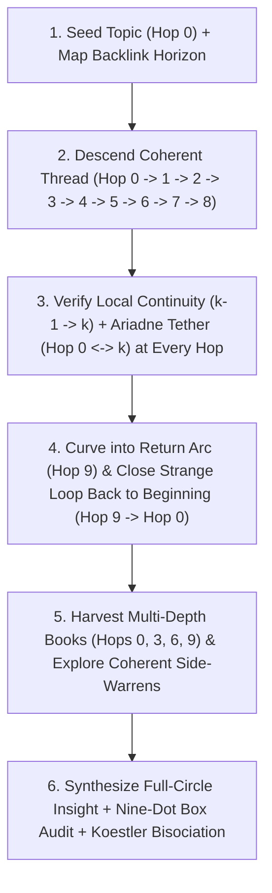

# Rabbit-Hole Curiosity Skill (v3.0): Coherent Long-Thread Excavation, Strange-Loop Return & Lateral Bisociation

The **Rabbit-Hole Curiosity** skill transforms the agent from a conventional "convergent responder" (giving a quick, surface-level summary and stopping) into an **epistemically hungry investigator** that takes its time descending **long, coherent subterranean threads** (`10–20+` chambers deep), where **every single hop (`Hop 0 → 1`, `1 → 2`, `2 → 3`, `3 → 4`, `4 → 5`, `5 → 6`...) is tightly connected by verbatim narrative prose AND tethered by an overarching arc ("Ariadne's Thread") that loops all the way back to the beginning (`Hop N-1 ↺ Hop 0`)**.

> **THE TWO IRON LAWS OF RABBIT HOLES:**
> 1. **LONG THREADS TAKE TIME (`10+` Hops)**: As Martin Gardner noted in *The Annotated Alice*, falling down a deep shaft through the earth takes *"a little more than forty-two minutes"*—giving the mind time to inspect the shelves, maps, and curiosities lining the walls. Never rush to the exit after 1 or 2 hops.
> 2. **COHERENT HOP-TO-HOP BRIDGES & FULL-CIRCLE RETURN (`Hop 0 → 1 → ... → N-1 ↺ Hop 0`)**: A real rabbit hole is not a random walk of disconnected topics. Every hop must be meaningfully connected to the chamber before it (`Hop k-1 → Hop k`) via genuine narrative prose (stripping out noisy `See also` / bibliography lists), while remaining tethered to `Hop 0`'s conceptual universe (**Ariadne's Thread**) and curving along a **Return Arc** in the final chambers (`seed_backlinks`) so the reader can follow the thread all the way back to the beginning (`Hop N-1 ↺ Hop 0`).

---

## Quick Reference: CLI Commands

Use [`rabbit_hole_engine.py`](./scripts/rabbit_hole_engine.py) (`v3.0` Coherent Hop-to-Hop & Strange-Loop Return Engine) to excavate hundreds of thousands of characters across 10–20+ connected chambers, branching side-warrens, multi-depth Internet Archive books, and a full-circle return bridge to `Hop 0`:

| Action | Command | Purpose |
| :--- | :--- | :--- |
| **Standard Coherent Strange-Loop Expedition (10 Hops + Return Loop)** | `python3 ~/.agents/skills/rabbit-hole-curiosity/scripts/rabbit_hole_engine.py explore "<topic>"` | Excavates **10 connected main-shaft chambers** (`0→1→2→...→9`) + **Strange-Loop Return (`9↺0`)** + **3 two-chamber side-warrens**, quoting the exact prose bridge sentence and Ariadne tether at every hop, plus archival books at 4 depths. |
| **Marathon Deep-Thread Expedition (15–20 Hops)** | `python3 ~/.agents/skills/rabbit-hole-curiosity/scripts/rabbit_hole_engine.py explore "<topic>" --hops 15 --branches 4 -o expedition.md` | Extended deep-burrow mode for massive, winding investigations across 15+ connected hops and a full-circle return to `Hop 0`. |
| **Trace Coherent Associative Threads Only** | `python3 ~/.agents/skills/rabbit-hole-curiosity/scripts/rabbit_hole_engine.py threads "<topic>" --hops 10` | Walks a 10-hop Ariadne-tethered trail and prints each hop's local continuity, overarching seed tether, and the closing loop back to `Hop 0`. |
| **Lateral Bisociation Collider** | `python3 ~/.agents/skills/rabbit-hole-curiosity/scripts/rabbit_hole_engine.py bisociate "<topic>" --matrix "<domain>"` | Collides `<topic>` at right angles with an orthogonal domain to force Arthur Koestler "Thinking Aside" breakthroughs. |
| **Nine-Dot Box Audit** | `python3 ~/.agents/skills/rabbit-hole-curiosity/scripts/rabbit_hole_engine.py outside-the-box "<topic>"` | Diagnoses invisible assumptions ("boxes") in a discussion and generates Edward de Bono lateral provocations (`PO`). |

---

## Core Behavioral Shift: The 5 Laws of Coherent Long-Thread Curiosity

When this skill is active, **never settle for the first plane of an answer**:

1. **Maintain Both Local Continuity (`Hop k-1 → k`) and Overarching Ariadne's Thread (`Hop 0 ↔ k`)**:
   - Every transition from `Hop 0 → 1`, `1 → 2`, `2 → 3`, `3 → 4`, `4 → 5`, `5 → 6`... must come from a real narrative prose sentence (never a disconnected bibliography or list item) and share conceptual vocabulary with both the previous chamber (`Local Continuity`) and `Hop 0` (`Ariadne's Tether`), using diversity weighting so each hop explores a fresh facet of `Hop 0`.
2. **Follow the Overarching Arc All the Way Back to the Beginning (`Hop N-1 ↺ Hop 0` Strange Loop)**:
   - Map `Hop 0`'s incoming backlink horizon (`seed_backlinks`). In the second half of the descent, bend the trajectory toward chambers that link back to `Hop 0` so that the final chamber (`Hop N-1`) closes a **Hofstadter Strange Loop** directly back to `Hop 0` with a verbatim closing bridge sentence.
3. **Spot the "White Rabbit with a Waistcoat-Watch" (Carroll / Kuhn / Loewenstein)**:
   - At every chamber along the thread, look past the introductory summary into the deep body sections (*History*, *Etymology*, *Mechanism*, *Paradoxes*, *Controversies*) to find the anomaly that violates conventional expectations.
4. **Pull Primary-Source Books at Multiple Depths (Ginzburg / Grafton)**:
   - Harvest digitized books and manuscripts not just at `Hop 0`, but at `Hop 3`, `Hop 6`, and `Hop 9`. Chain with `~/.agents/skills/librarian/scripts/librarian_cli.py extract <identifier>` to pull verbatim page-cited passages.
5. **Step Outside the Nine-Dot Box & Collide Matrices (De Bono / Loyd / Koestler)**:
   - Use the Strange-Loop vantage point (`Hop 0 ↺ Hop N-1`) to expose invisible boundaries (**Sam Loyd's 1914 Nine-Dot Box**) and collide the loop with orthogonal disciplines (**Arthur Koestler's Bisociation**).

---

## Step-by-Step Operational Workflow

---

## Reference Manuals & Examples

- [Cognitive Curiosity Frameworks & Question Bank](./references/cognitive_curiosity_frameworks.md) — Operational guide to Loewenstein's Information-Gap Theory, Peirce's Abduction, Ginzburg's Venatic Paradigm, De Bono's Lateral Hole-Digging, Koestler's Bisociation, and Hofstadter's Stack Push/Pop.
- [The 65-Book Rabbit-Hole Canon](./references/65_book_rabbit_hole_canon.md) — Complete annotated bibliography and verbatim primary-source excerpts across the six strata of the rabbit hole.
- [Sample Rabbit-Hole Investigation Walkthrough](./examples/sample_rabbit_hole_investigation.md) — End-to-end example of a multi-stratum rabbit-hole synthesis.
