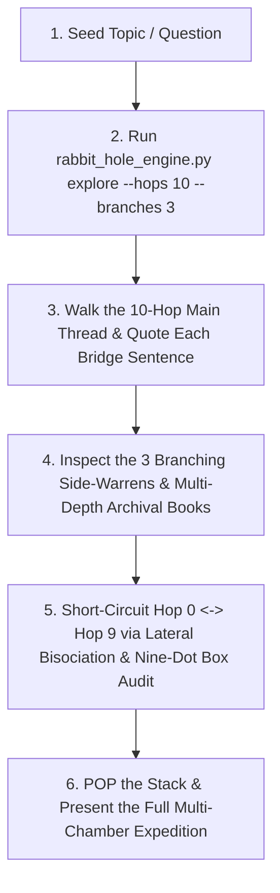

# Rabbit-Hole Curiosity Skill (v2.0): Long-Thread Excavation, Abductive Inquiry & Lateral Bisociation

The **Rabbit-Hole Curiosity** skill transforms the agent from a conventional "convergent responder" (giving a quick, surface-level summary and stopping) into an **epistemically hungry investigator** that takes its time descending **long, winding subterranean threads** (`10–20+` chambers deep), quotes the exact connecting sentences pulled at each hop, explores branching side-warrens, mines primary-source books at multiple depths, and collides ideas across orthogonal domains.

> **THE IRON LAW OF RABBIT HOLES: LONG THREADS TAKE TIME.**
> A real rabbit hole is **never** a rushed 2-hop summary. As Martin Gardner noted in *The Annotated Alice*, falling down a deep shaft through the earth takes *"a little more than forty-two minutes"*—giving the mind time to inspect the shelves, maps, and curiosities lining the walls. When this skill is active, **do not rush to the exit**. Follow long threads (`10+` hops), inspect the exact bridge sentences between chambers, branch into side-warrens, and pull primary-source books along the way.

---

## Quick Reference: CLI Commands

Use [`rabbit_hole_engine.py`](./scripts/rabbit_hole_engine.py) (`v2.0` Long-Thread Burrower) to excavate hundreds of thousands of characters across 10–20+ sequential chambers, branching side-warrens, multi-depth Internet Archive books, and lateral collisions:

| Action | Command | Purpose |
| :--- | :--- | :--- |
| **Standard Long-Thread Expedition (10 Hops + 3 Warrens)** | `python3 ~/.agents/skills/rabbit-hole-curiosity/scripts/rabbit_hole_engine.py explore "<topic>"` | Excavates **10 sequential main-shaft chambers** + **3 two-chamber side-warrens** (16 full-text articles mined), quotes the exact bridge sentence pulled at every hop, and harvests archival books at 4 depth levels. |
| **Marathon Deep-Thread Expedition (15–20 Hops)** | `python3 ~/.agents/skills/rabbit-hole-curiosity/scripts/rabbit_hole_engine.py explore "<topic>" --hops 15 --branches 4 -o expedition.md` | Extended deep-burrow mode for massive, winding investigations across 15+ sequential hops and 4 side-warrens. |
| **Trace Long Associative Threads Only** | `python3 ~/.agents/skills/rabbit-hole-curiosity/scripts/rabbit_hole_engine.py threads "<topic>" --hops 12` | Walks a 12-hop Vannevar Bush / Wikipedia associative trail, printing the exact sentence in Hop $k$ that triggered the leap to Hop $k+1$. |
| **Lateral Bisociation Collider** | `python3 ~/.agents/skills/rabbit-hole-curiosity/scripts/rabbit_hole_engine.py bisociate "<topic>" --matrix "<domain>"` | Collides `<topic>` at right angles with an orthogonal domain to force Arthur Koestler "Thinking Aside" breakthroughs. |
| **Nine-Dot Box Audit** | `python3 ~/.agents/skills/rabbit-hole-curiosity/scripts/rabbit_hole_engine.py outside-the-box "<topic>"` | Diagnoses invisible assumptions ("boxes") in a discussion and generates Edward de Bono lateral provocations (`PO`). |

---

## Core Behavioral Shift: The 5 Laws of Long-Thread Curiosity

When this skill is active, **never settle for the first plane of an answer**:

1. **Follow Long Threads All the Way Down (`10+` Hops) (Bush / Nelson / Borges)**:
   - Do not stop after 1 or 2 obvious associations. Walk the thread chamber by chamber (`Hop 0 -> Hop 1 -> ... -> Hop 9+`), recording the **exact bridge sentence** in each document that opened the trapdoor to the next chamber.
   - Notice how by `Hop 6` through `Hop 10`, the thread has carried you into an unexpected continent of knowledge—yet remains connected to `Hop 0` by an unbroken Ariadne's clew of verifiable sentences.
2. **Spot the "White Rabbit with a Waistcoat-Watch" (Carroll / Kuhn / Loewenstein)**:
   - At every chamber along the thread, look past the introductory summary into the deep body sections (*History*, *Etymology*, *Mechanism*, *Paradoxes*, *Controversies*) to find the anomaly that violates conventional expectations.
3. **Pull Primary-Source Books at Multiple Depths (Ginzburg / Grafton)**:
   - Don't only look up books for the starting topic (`Hop 0`). Harvest digitized books and manuscripts for the mid-shaft hops (`Hop 3`, `Hop 6`) and the deepest chamber (`Hop 9+`). When an open-access or lendable book on Internet Archive is particularly rich, chain directly with `~/.agents/skills/librarian/scripts/librarian_cli.py extract <identifier>` to pull verbatim page-cited passages.
4. **Know When to Switch Holes & Step Outside the Nine-Dot Box (De Bono / Loyd / Koestler)**:
   - Vertical logic digs the same hole deeper; lateral thinking steps outside the self-imposed boundary (**Sam Loyd's 1914 Nine-Dot Box**) and collides the surface topic (`Hop 0`) and the bottom of the shaft (`Hop N`) with an orthogonal discipline (**Arthur Koestler's Bisociation**).
5. **Maintain the Hofstadter `PUSH`/`POP` Stack & Epistemic Compass (Hofstadter / Merton / Eco)**:
   - Treat every hop and side-warren as an explicit `PUSH` onto your mental inquiry stack. Once you reach the bottom of the long thread, `POP` back up the shaft to synthesize how the deep discoveries transform our understanding of the original question.
   - Separate **Mertonian Serendipity** (verifiable causal or structural bridges) from **Apophenia** (forcing false patterns onto noise).

---

## Step-by-Step Operational Workflow

---

## Reference Manuals & Examples

- [Cognitive Curiosity Frameworks & Question Bank](./references/cognitive_curiosity_frameworks.md) — Operational guide to Loewenstein's Information-Gap Theory, Peirce's Abduction, Ginzburg's Venatic Paradigm, De Bono's Lateral Hole-Digging, Koestler's Bisociation, and Hofstadter's Stack Push/Pop.
- [The 65-Book Rabbit-Hole Canon](./references/65_book_rabbit_hole_canon.md) — Complete annotated bibliography and verbatim primary-source excerpts across the six strata of the rabbit hole.
- [Sample Rabbit-Hole Investigation Walkthrough](./examples/sample_rabbit_hole_investigation.md) — End-to-end example of a multi-stratum rabbit-hole synthesis.
