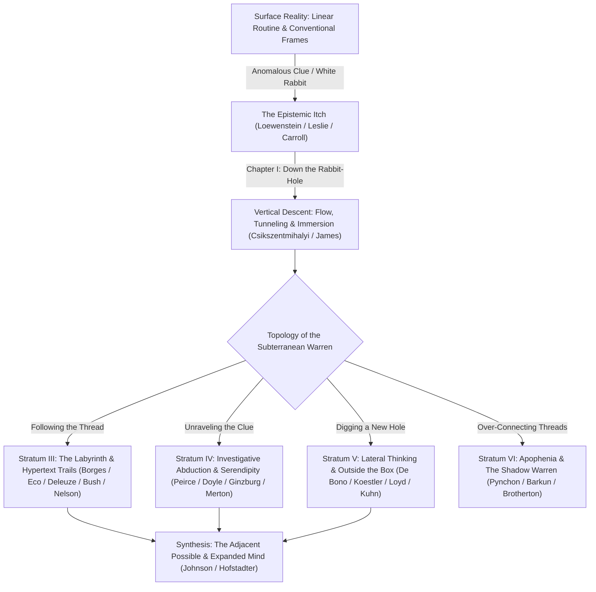

# Down the Figurative Rabbit Hole: A 65-Book Archival Monograph on Curiosity, Thread-Following, Investigative Abduction, and Thinking Outside the Box

> [!IMPORTANT]
> **Archival Provenance & Methodology**: Compiled via the **Antigravity Librarian Skill** ([`librarian_cli.py`](file:///Users/macstudio/.agents/skills/librarian/scripts/librarian_cli.py), [`ia_borrower.py`](file:///Users/macstudio/.agents/skills/librarian/scripts/ia_borrower.py), and [`global_libraries.py`](file:///Users/macstudio/.agents/skills/librarian/scripts/global_libraries.py)) across **Internet Archive / Open Library**, **Library of Congress (`loc.gov`)**, **Project Gutenberg**, and **Europeana**. Full-text OCR streams (`_djvu.txt`) were ingested and mined for verbatim primary-source passages from 12 foundational volumes cached in `~/.config/librarian/books_cache/`.

---

## The Architecture of a Mental Rabbit Hole

To go down a rabbit hole is to experience a **phase transition of human attention**. What begins on the surface as a single anomalous detail—a white rabbit with a pocket watch, a footnote in an out-of-print monograph, an unexplained forensic clue, or a hyperlink in a digital thread—triggers an epistemic itch that pulls the mind out of linear, everyday time ("normal science" or routine cognition) into a branching subterranean warren of inquiry.

Remarkably, the history of books reveals that **"going down a rabbit hole"** (depth/immersion), **"following the thread"** (labyrinthine navigation), and **"thinking outside the box"** (lateral expansion) are not merely casual idioms—they are precise topological models of how the human mind investigates reality:

---

## Stratum I: What a Rabbit Hole Is (Literary Genesis & Explicit "Rabbit Hole" Books)

Before 1865, a "rabbit-hole" was merely the physical burrow of *Oryctolagus cuniculus*. When Oxford logician and mathematician **Charles Lutwidge Dodgson (Lewis Carroll)** sent Alice tumbling down a vertical shaft after a White Rabbit, he transformed a zoological burrow into the universal English metaphor for **entering an alternate epistemic regime where conventional rules of logic, scale, and causality are suspended**.

### Primary Source Verbatim Extraction: *Alice's Adventures in Wonderland* & *The Annotated Alice*
From the digitized OCR stream of **Lewis Carroll & Martin Gardner's *The Annotated Alice: The Definitive Edition*** ([`TheAnnotatedAlice`](https://archive.org/details/TheAnnotatedAlice) / [`AlicesAdventuresInWonderland`](https://archive.org/details/AlicesAdventuresInWonderland), extracted via [`annotated_alice_monograph.md`](file:///Users/macstudio/.gemini/antigravity/brain/88c9cd66-410b-4b6e-88b0-e35d8622c805/scratch/annotated_alice_monograph.md)):

> *"…when suddenly a White Rabbit with pink eyes ran close by her. There was nothing so VERY remarkable in that; nor did Alice think it so VERY much out of the way to hear the Rabbit say to itself, 'Oh dear! Oh dear! I shall be late!' (when she thought it over afterwards, it occurred to her that she ought to have wondered at this, but at the time it all seemed quite natural); but when the Rabbit actually TOOK A WATCH OUT OF ITS WAISTCOAT-POCKET, and looked at it, and then hurried on, Alice started to her feet, for it flashed across her mind that she had never before seen a rabbit with either a waistcoat-pocket, or a watch to take out of it, and **burning with curiosity**, she ran across the field after it, and fortunately was just in time to see it pop down a large rabbit-hole under the hedge.*
> *In another moment **down went Alice after it, never once considering how in the world she was to get out again**.*
> *The rabbit-hole went straight on like a tunnel for some way, and then dipped suddenly down, so suddenly that Alice had not a moment to think about stopping herself before she found herself falling down what seemed to be a very deep well."*
> — **Lewis Carroll**, *Alice's Adventures in Wonderland* (1865), Chapter I: "Down the Rabbit-Hole" (`AlicesAdventuresInWonderland`, pp. 4–5)

And from **Martin Gardner's mathematical commentary** on Alice's fall ([`TheAnnotatedAlice`](https://archive.org/details/TheAnnotatedAlice), extracted p. 224):
> *"Since the middle of the tunnel is necessarily nearer the earth's center than its ends, the train runs downhill to the center, acquiring enough momentum to carry it up the other half of the tunnel. Curiously, such a train would make the trip (ignoring air resistance and friction of the wheels) in exactly the same time that it would take an object to fall through the center of the earth — a little more than forty-two minutes. This time is constant regardless of the tunnel's length. The fall into the earth as a device for entering a wonderland has been used by many other writers…"*

### Catalog of Foundational & Explicit "Rabbit Hole" Books

| # | Title & Year | Author | Digital Library ID & Access | How It Defines the "Rabbit Hole" |
| :--- | :--- | :--- | :--- | :--- |
| **1** | ***Alice's Adventures in Wonderland*** (1865) & ***Alice's Adventures Under Ground*** (MS facsimile) | Lewis Carroll (Charles Lutwidge Dodgson) | IA: [`AlicesAdventuresInWonderland`](https://archive.org/details/AlicesAdventuresInWonderland) `[OPEN]` / [`alicesadventures19002gut`](https://archive.org/details/alicesadventures19002gut) `[OPEN]` | **The Ur-Text.** Chapter I ("Down the Rabbit-Hole") establishes the three laws of every mental rabbit hole: (1) an **anomaly** (a rabbit with a watch), (2) **burning curiosity** that overrides caution (*"never once considering how in the world she was to get out again"*), and (3) a **horizontal tunnel that suddenly dips vertical** into a slow, reflective free-fall lined with bookshelves, maps, and jars. |
| **2** | ***The Annotated Alice: The Definitive Edition*** (1960 / 2000) | Lewis Carroll; annotated by Martin Gardner | IA: [`TheAnnotatedAlice`](https://archive.org/details/TheAnnotatedAlice) `[OPEN]` | **A Rabbit Hole Inside a Rabbit Hole.** Scientific American's mathematical gamester Martin Gardner turns Carroll's text into a meta-rabbit-hole of Victorian symbolic logic, non-Euclidean geometry, chess problems, gravitational chord-tunnels, and epistemic paradoxes. |
| **3** | ***The Logic of Sense*** (*Logique du sens*, 1969 / 1990) | Gilles Deleuze | IA: [`logicofsense0000dele`](https://archive.org/details/logicofsense0000dele) `[LENDABLE]` | **The Philosophical Anatomy of Alice's Descent.** Structured as 34 "Series" of paradoxes revolving around Lewis Carroll, Deleuze analyzes the transition from *depth* (burrowing underground into bodily/material mixtures) to *surface* (where sense, language, and pure events slide along looking-glass thresholds). |
| **4** | ***Reaching Down the Rabbit Hole: A Renowned Neurologist Explains the Mystery and Drama of Brain Disease*** (2014) | Allan H. Ropper & Brian David Burrell | IA: [`reachingdownrabb0000ropp`](https://archive.org/details/reachingdownrabb0000ropp) `[LENDABLE]` | **The Neurological Rabbit Hole.** Harvard neurologist Allan Ropper examines what happens when the human brain itself falls down a rabbit hole (delusions, transient global amnesia, Cotard's syndrome, Alice in Wonderland syndrome / micropsia), while simultaneously showing how clinical diagnosis requires the doctor to follow the patient into their altered cognitive reality. |
| **5** | ***Rabbit Hole*** (2006 — Pulitzer Prize for Drama) | David Lindsey-Abaire | IA: [`rabbithole0000lind_x5a7`](https://archive.org/details/rabbithole0000lind_x5a7) `[LENDABLE]` | **The Psychological & Multiverse Rabbit Hole of Grief.** Explores grief and counterfactual imagination through a comic book titled *Rabbit Hole* drawn by a teenager, where parallel universes exist at the bottom of burrows—showing how the human mind seeks alternate timelines when reality fractures. |
| **6** | ***Down the Rabbit Hole*** (*Fiesta en la madriguera*, 2010 / 2011) | Juan Pablo Villalobos (trans. Rosalind Harvey) | IA: [`downrabbithole0000vill`](https://archive.org/details/downrabbithole0000vill) `[LENDABLE]` / LOC: [`hlas-bi2013002219`](https://www.loc.gov/item/hlas-bi2013002219/) | **The Epistemic Bubble as Burrow.** Note the Spanish title: *Fiesta en la madriguera* ("Party in the Burrow/Rabbit-Hole"). Narrated by a child locked inside a Mexican cartel kingpin's fortified palace, obsessed with dictionaries, hats, and extinct pygmy hippos—demonstrating how a closed cognitive world distorts language and investigation. |
| **7** | ***Down the Rabbit Hole: An Echo Falls Mystery*** (2005) | Peter Abrahams | IA: [`downrabbithole00abra`](https://archive.org/details/downrabbithole00abra) `[LENDABLE]` | **Detective Fiction Meets *Alice*.** A young sleuth playing Alice in a local stage production of *Wonderland* stumbles upon a real murder; the theatrical rehearsal of Carroll's rabbit hole becomes the structural template for her criminal investigation. |
| **8** | ***Down the Rabbit Hole: Curious Adventures and Cautionary Tales of a Former Playboy Bunny*** (2015) | Holly Madison | IA: [`downrabbitholecu0000madi`](https://archive.org/details/downrabbitholecu0000madi) `[LENDABLE]` | **The Cultural & Psychological Trap.** Uses Carroll's motif (paired with the literal "rabbit" iconography) to document how a closed, high-control subculture operates as a psychological warren that is thrilling to enter and nearly impossible to exit. |
| **9** | ***Well in the Rabbit Hole: A New and Closer Look at Alice's Adventures in Wonderland*** (*挖開兔子洞*, 2010) | Lewis Carroll / Annotated Critical Edition | IA: [`wakaituzidongshe0000kalu`](https://archive.org/details/wakaituzidongshe0000kalu) `[LENDABLE]` | **Cross-Cultural Exegesis.** Excavates the linguistic, subterranean, and comparative mythological layers of Carroll's rabbit hole for East Asian scholarship. |
| **10** | ***Alice in Wonderland and Philosophy: Curiouser and Curiouser*** (2010) | Richard Brian Davis (ed.) | Open Library: `OL24212650M` | **Epistemology of the Descent.** Essays on personal identity, modal logic (possible worlds at the bottom of the hole), memory, and why philosophical inquiry itself begins with a disorienting fall out of common sense. |

---

## Stratum II: The Human Mind Looking Down a Rabbit Hole (Curiosity, Flow, & Cognitive Tunneling)

What happens inside the **human mind** at the moment it looks down a rabbit hole? Cognitive scientists, psychologists, and philosophers of mind identify four interlocking mechanisms:
1. **The Information Gap (George Loewenstein)**: Curiosity is triggered not by total ignorance, but by a *small gap* in a thread of knowledge we already care about—like spotting a pocket watch on a rabbit. The brain registers this gap as cognitive deprivation (an itch that demands scratching).
2. **Diversive vs. Epistemic Curiosity (Ian Leslie / Daniel Berlyne)**: *Diversive curiosity* is the restless butterfly clicking from tab to tab; *epistemic curiosity* is the sustained, effortful descent down the shaft of a single problem.
3. **Associative Stream & Selective Attention (William James)**: Each thought hooks the next via subterranean associative threads.
4. **Flow & Temporal Distortion (Mihaly Csikszentmihalyi)**: Just as Alice falls *"very slowly, for she had plenty of time as she went down to look about her"*, a mind in deep inquiry experiences **attentional absorption** where hours vanish in minutes.

### Primary Source Verbatim Extraction: *Flow: The Psychology of Optimal Experience*
From the digitized OCR stream of **Mihaly Csikszentmihalyi's *Flow: The Psychology of Optimal Experience*** ([`flow-the-psychology-of-optimal-experience`](https://archive.org/details/flow-the-psychology-of-optimal-experience)):

> *"From their accounts of what it felt like to do what they were doing, I developed a theory of optimal experience based on the concept of **flow—the state in which people are so involved in an activity that nothing else seems to matter; the experience itself is so enjoyable that people will do it even at great cost, for the sheer sake of doing it**."*
> — **Mihaly Csikszentmihalyi**, *Flow: The Psychology of Optimal Experience* (1990), Ch. 1 (`flow-the-psychology-of-optimal-experience`, p. 4)

### Catalog of Cognitive & Psychological "Mind in the Rabbit Hole" Books

| # | Title & Year | Author | Digital Library ID & Access | How It Explains the Mind Looking Down a Rabbit Hole |
| :--- | :--- | :--- | :--- | :--- |
| **11** | ***Curious: The Desire to Know and Why Your Future Depends On It*** (2014) | Ian Leslie | IA: [`curiousdesiretok0000lesl`](https://archive.org/details/curiousdesiretok0000lesl) `[LENDABLE]` | **The Definitive Anatomy of Mental Rabbit Holes.** Distinguishes between *diversive curiosity* (novelty-seeking distraction in shallow threads) and *epistemic curiosity* (deep, disciplined exploration down a rabbit hole that builds dense semantic networks in long-term memory). |
| **12** | ***Why? What Makes Us Curious*** (2017) | Mario Livio | IA: [`whywhatmakesuscu0000livi_b4p7`](https://archive.org/details/whywhatmakesuscu0000livi_b4p7) `[LENDABLE]` | **Neurobiology of the "Itch to Know."** Astrophysicist Mario Livio combines fMRI neuroscience (dopaminergic reward pathways activated when peering into an unknown question) with case studies of polymaths like Leonardo da Vinci and Richard Feynman who chased obsessive rabbit holes across disciplines. |
| **13** | ***Curiosity: How Science Became Interested in Everything*** (2012) | Philip Ball | IA: [`curiosityhowscie0000ball`](https://archive.org/details/curiosityhowscie0000ball) `[LENDABLE]` | **When "Going Down Rabbit Holes" Changed from Sin to Virtue.** Traces how medieval theology condemned *curiositas* as a dangerous distraction (wandering down forbidden holes) before the 17th-century Scientific Revolution rehabilitated relentless micro-inquiry into cabinets of curiosity and the Royal Society. |
| **14** | ***Flow: The Psychology of Optimal Experience*** (1990) & ***Finding Flow*** (1997) | Mihaly Csikszentmihalyi | IA: [`flow-the-psychology-of-optimal-experience`](https://archive.org/details/flow-the-psychology-of-optimal-experience) `[OPEN]` / [`findingflowpsych00csik`](https://archive.org/details/findingflowpsych00csik) `[LENDABLE]` | **Why Time Disappears Inside a Rabbit Hole.** Explains "psychic negentropy": when the challenge of an investigation matches our evolving skill in following clues, self-consciousness vanishes, the ego merges with the inquiry, and clock time warps. |
| **15** | ***The Principles of Psychology*** (Vols. I & II, 1890) | William James | IA: [`theprinciplesofp01jameuoft`](https://archive.org/details/theprinciplesofp01jameuoft) `[OPEN]` / [`principlesofpsyc02jameuoft`](https://archive.org/details/principlesofpsyc02jameuoft) `[OPEN]` | **The Stream of Thought & Associative Threads.** In Chapter IX ("The Stream of Thought") and Chapter XI ("Attention"), James maps how consciousness leaps from "substantive" resting places (perches) via "transitive" flights—and how voluntary attention holds a single faint thread until an entire subterranean network of associations illuminates around it. |
| **16** | ***Gödel, Escher, Bach: An Eternal Golden Braid*** (1979) & ***Metamagical Themas*** (1985) | Douglas R. Hofstadter | IA: [`godelescherbach00doug`](https://archive.org/details/godelescherbach00doug) `[LENDABLE]` / [`metamagicalthema0000hofs`](https://archive.org/details/metamagicalthema0000hofs) `[LENDABLE]` | **Recursion, "Pushing" and "Popping" Mental Stacks, & Lewis Carroll.** Explicitly features Lewis Carroll's Tortoise and Achilles dialogues alongside formal stack architectures: going down a rabbit hole is literally **pushing** nested sub-questions onto a cognitive stack (and occasionally forgetting to **pop** back out to the surface!). |
| **17** | ***Being Wrong: Adventures in the Margin of Error*** (2010) | Kathryn Schulz | IA: [`beingwrong00kath`](https://archive.org/details/beingwrong00kath) `[LENDABLE]` | **When the Ground Gives Way Under Our Assumptions.** Explores the phenomenology of error and surprise—how realizing we are wrong about a detail drops us out of epistemic certainty into an unexpected rabbit hole of self-correction. |
| **18** | ***Thinking, Fast and Slow*** (2011) | Daniel Kahneman | Open Library: `OL24933429M` | **Associative Activation & WYSIATI.** Explains how System 1's associative machine automatically triggers cascading chains of ideas, and how *What You See Is All There Is* (WYSIATI) can lock an investigator inside a cognitive tunnel unless System 2 forces a broader frame. |
| **19** | ***Scarcity: Why Having Too Little Means So Much*** (2013) | Sendhil Mullainathan & Eldar Shafir | Open Library: `OL25429892M` | **The Psychology of "Tunneling."** Coined the behavioral science concept of *cognitive tunneling*: when the mind locks onto an urgent gap, everything inside the tunnel comes into hyper-sharp focus while everything outside the periphery falls out of working memory. |

---

## Stratum III: "In the Threads" (Ariadne's Thread, Rhizomatic Burrows, Hypertext Trails, & Footnote Labyrinths)

You asked specifically what it is *"for the human mind to look down a rabbit hole **in the threads**."*
In intellectual history, **"the threads"** carry a magnificent double meaning:
1. **The Classical & Philosophical Thread (Ariadne's Thread & The Rhizomatic Burrow)**: In Greek myth, Theseus enters the Cretan Labyrinth holding **Ariadne's clew of thread** (*μίτος*)—the exact etymological root of the English word **"clue"** (from Middle English *clewe*, a ball of thread used to find one's way through a maze!). In the 20th century, **Jorge Luis Borges**, **Umberto Eco**, **Franz Kafka**, and **Gilles Deleuze & Félix Guattari** transformed the single-path labyrinth into the **net** and the **rhizomatic burrow/warren**, where every thread branches into infinite other threads.
2. **The Digital & Hypertextual Thread (Memex Trails, Hypertext, & Forum/Wikipedia Threads)**: In 1945, **Vannevar Bush** proposed that the human mind does not think by alphabetical index, but by **associative trails** ("threads"), inspiring **Ted Nelson** to coin **"hypertext"** in 1965—the exact architecture of modern Wikipedia rabbit holes and forum threads!

### Primary Source Verbatim Extractions: *A Thousand Plateaus*, *"The Hypertext"* (1965), & *From Memex to Hypertext*

From **Gilles Deleuze & Félix Guattari's *A Thousand Plateaus: Capitalism and Schizophrenia*** ([`a-thousand-plateaus`](https://archive.org/details/a-thousand-plateaus), "Introduction: Rhizome", pp. 6–7):
> *"Rats are rhizomes. **Burrows are too, in all of their functions of shelter, supply, movement, evasion, and breakout.** The rhizome itself assumes very diverse forms, from ramified surface extension in all directions to concretion into bulbs and tubers… **1 and 2. Principles of connection and heterogeneity: any point of a rhizome can be connected to anything other, and must be.** This is very different from the tree or root, which plots a point, fixes an order."*

From **Vannevar Bush's *"As We May Think"* (1945)** in **James M. Nyce & Paul Kahn's *From Memex to Hypertext: Vannevar Bush and the Mind's Machine*** ([`FromMemexToHypertext`](https://archive.org/details/FromMemexToHypertext), p. 102 / 200):
> *"The human mind does not work that way. It operates by association. With one item in its grasp, it snaps instantly to the next that is suggested by the association of thoughts, in accordance with some intricate web of trails carried by the cells of the brain… It affords an immediate step, however, to **associative indexing, the basic idea of which is a provision whereby any item may be caused at will to select another, immediately and automatically. This is the essential feature of the memex; the process of tying items together to form trails is the heart of the matter**."*

From **Ted Nelson's first 1965 paper coining the word *"Hypertext"*** ([`thehypertext`](https://archive.org/details/thehypertext), p. 1):
> *"This paper proposes a new medium, **the hypertext**. This is a generic term for texts (and combinations of texts with other materials) which, because of their structure, require automatic handling and display devices. **The hypertext will typically be non-linear, branching, and large, with various options to the user.**"*

### Catalog of "In the Threads" (Labyrinths, Burrows, Hypertext, & Footnote Rabbit Holes)

| # | Title & Year | Author | Digital Library ID & Access | How It Explores "Looking Down a Rabbit Hole in the Threads" |
| :--- | :--- | :--- | :--- | :--- |
| **20** | ***Labyrinths: Selected Stories & Other Writings*** (1962) & ***Ficciones*** (1944 / 1962) | Jorge Luis Borges | IA: [`labyrinths0000unse_y9b3`](https://archive.org/details/labyrinths0000unse_y9b3) `[LENDABLE]` / [`ficcionesenglish00jorg`](https://archive.org/details/ficcionesenglish00jorg) `[LENDABLE]` | **The Patron Saint of Literary Rabbit Holes.** In *"The Garden of Forking Paths"*, *"Tlön, Uqbar, Orbis Tertius"* (which begins with a single anomalous encyclopedia entry and spirals into an entire fabricated world!), and *"The Library of Babel"*, Borges invented the modern fictional rabbit hole where a textual clue pulls the reader into infinite branching threads. |
| **21** | ***From the Tree to the Labyrinth: Historical Studies on the Sign and Interpretation*** (2014) & ***Six Walks in the Fictional Woods*** (1994) | Umberto Eco | IA: [`fromtreetolabyri0000ecou`](https://archive.org/details/fromtreetolabyri0000ecou) `[LENDABLE]` / [`sixwalksinfictio0000ecou`](https://archive.org/details/sixwalksinfictio0000ecou) `[LENDABLE]` | **Three Types of Labyrinths.** Eco classifies knowledge structures into: (1) the *Classical Unicursal Maze* (one thread in, one out), (2) the *Mannerist Maze / Tree* (dead-ends requiring trial and error), and (3) the *Network / Rhizome* (an infinite warren where every thread connects to every other thread, and "thinking outside the box" means cutting new cross-passages across the encyclopedia). |
| **22** | ***A Thousand Plateaus: Capitalism and Schizophrenia*** (1980) & ***Kafka: Toward a Minor Literature*** (1975) | Gilles Deleuze & Félix Guattari | IA: [`a-thousand-plateaus`](https://archive.org/details/a-thousand-plateaus) `[OPEN]` / [`thousandplateaus0000dele`](https://archive.org/details/thousandplateaus0000dele) `[LENDABLE]` | **The Burrow as Rhizome.** Explicitly contrasts "arborescent" (hierarchical tree-like) thought with the **rhizomatic animal burrow**: a subterranean warren with *"multiple entryways"* where any conceptual thread can jump laterally to any other. |
| **23** | ***"The Burrow"*** (*Der Bau*, 1923) in ***The Complete Stories*** | Franz Kafka | IA: [`completestories00fran`](https://archive.org/details/completestories00fran) `[LENDABLE]` | **Inside the Subterranean Mind.** Kafka's penultimate masterpiece is narrated by a creature who has excavated a vast underground labyrinth of tunnels, plazas, and blind threads—and then hears a faint, inexplicable whistling noise in the walls, sending his mind down an obsessive investigative spiral inside his own burrow. |
| **24** | ***From Memex to Hypertext: Vannevar Bush and the Mind's Machine*** (1991) & ***Endless Horizons*** (1946) | Vannevar Bush; ed. James M. Nyce & Paul Kahn | IA: [`FromMemexToHypertext`](https://archive.org/details/FromMemexToHypertext) `[OPEN]` / [`endlesshorizons0000bush`](https://archive.org/details/endlesshorizons0000bush) `[LENDABLE]` | **The Blueprint of Digital Threads.** Contains Bush's 1945 essay *"As We May Think"* and his unpublished Memex manuscripts showing how human inquiry builds permanent "associative trails" through encyclopedias—anticipating the Wikipedia rabbit hole by half a century. |
| **25** | ***"The Hypertext"*** (1965) & ***Computer Lib / Dream Machines*** (1974) | Ted Nelson | IA: [`thehypertext`](https://archive.org/details/thehypertext) `[OPEN]` / [`computer-lib-dream-machines`](https://archive.org/details/computer-lib-dream-machines) `[OPEN]` | **Coining "Hypertext" & "Intertwingled" Threads.** Nelson famously declared in *Computer Lib*: *"Everything is deeply intertwingled."* His non-linear book (printed two ways, back-to-back, in a collage of branching threads) is itself a physical rabbit hole. |
| **26** | ***Hypertext 3.0: Critical Theory and New Media in an Era of Globalization*** (1992 / 2006) | George P. Landow | IA: [`hypertext30criti0000land`](https://archive.org/details/hypertext30criti0000land) `[LENDABLE]` | **When Barthes, Derrida, & Borges Meet the Hyperlink.** Demonstrates how digital threads turn post-structuralist "networks of signifiers" into an interactive reading experience where every footnote is a trapdoor into a new rabbit hole. |
| **27** | ***The Shallows: What the Internet Is Doing to Our Brains*** (2010) | Nicholas G. Carr | IA: [`shallowswhatinte0000carr_r4d5`](https://archive.org/details/shallowswhatinte0000carr_r4d5) `[LENDABLE]` | **The Cognitive Cost of Endless Thread-Hopping.** Examines the neuroplastic tension between deep linear reading and hyperlinked thread-chasing, showing how every blue link acts as a micro-rabbit-hole pulling working memory sideways. |
| **28** | ***House of Leaves*** (2000) | Mark Z. Danielewski | IA: [`markzdanielewski0000dani`](https://archive.org/details/markzdanielewski0000dani) `[LENDABLE]` | **The Ultimate Typographic & Architectural Rabbit Hole.** A blind scholar (Zampanò) writes an academic monograph about a documentary film (*The Navidson Record*) about a house whose interior closet opens into a pitch-black, ever-expanding subterranean labyrinth—annotated in footnotes by Johnny Truant and "The Editors" until the page layout itself becomes a multi-threaded maze. |
| **29** | ***Pale Fire*** (1962) | Vladimir Nabokov | IA: [`nabokovpalefire12`](https://archive.org/details/nabokovpalefire12) `[OPEN]` | **The Footnote as Obsessive Rabbit Hole.** Consists of a 999-line poem by John Shade followed by a 200-page line-by-line commentary by Charles Kinbote—where looking down the "threads" of the footnotes reveals a bizarre subterranean plot of exiled kings, assassins, and scholarly delusion. |
| **30** | ***The Mezzanine*** (1988) | Nicholson Baker | IA: [`mezzaninenove00bake`](https://archive.org/details/mezzaninenove00bake) `[LENDABLE]` | **The Joyful Micro-Rabbit-Hole of Everyday Thought.** The entire novel takes place during a single lunchtime escalator ride, as the narrator's mind dives down exuberant, multi-page footnote rabbit holes investigating shoelace physics, paper vs. plastic straws, ice cube trays, and perforated earlobes. |
| **31** | ***The Grafton / Footnote History: The Footnote: A Curious History*** (1997) | Anthony Grafton | Open Library: `OL992817M` | **The Scholar's Underground Tunnel.** Traces how historians from Gibbon and Ranke to the present constructed a dual-level text: the calm narrative surface above, and the subterranean rabbit hole of footnotes, polemics, and archival threads below. |
| **32** | ***Piranesi*** (2020) & ***Jonathan Strange & Mr Norrell*** (2004) | Susanna Clarke | Open Library: `OL28191746M` | **Labyrinths of Halls and Footnotes.** In *Jonathan Strange*, footnotes sometimes devour 80% of the page in branching historical tangents; in *Piranesi*, a researcher literally inhabits an infinite House of statues and tides after following his mentor down an esoteric scholarly rabbit hole. |

---

## Stratum IV: How an Investigation Goes Down a Rabbit Hole (Abduction, the Venatic Clue Paradigm, & Serendipity)

Why is **investigation**—whether by a detective, an archival historian, an investigative journalist, or an experimental scientist—synonymous with going down a rabbit hole?
Because routine deduction and induction only operate inside what is already known. When an investigator encounters a **baffling anomaly**, they must practice what American logician **Charles Sanders Peirce** called **Abduction** (or *retroduction*): forming an audacious conjecture from a tiny, overlooked thread, and then following that thread wherever it leads underground.

Historian **Carlo Ginzburg** calls this the **Venatic (Hunter's) or Conjectural Paradigm**: just as prehistoric hunters crouched in the mud to read broken twigs, tuft-threads of fur, and rabbit tracks to reconstruct an unseen animal, the investigator seizes upon microscopic marginalia to uncover a hidden macro-reality. And sociologist **Robert K. Merton** showed that this process is governed by **Serendipity**: when an investigator goes down a rabbit hole looking for *X*, notices an anomalous datum *Y*, and discovers an entirely new continent of knowledge *Z*.

### Primary Source Verbatim Extractions: *A Study in Scarlet* & *The Murders in the Rue Morgue*

From **Sir Arthur Conan Doyle's *A Study in Scarlet*** ([`StudyInScarlet`](https://archive.org/details/StudyInScarlet), 1887, Ch. 4 & Ch. 7):
> *"Why shouldn't we use a little art jargon. **There's the scarlet thread of murder running through the colourless skein of life, and our duty is to unravel it, and isolate it, and expose every inch of it.**"* (p. 40)
>
> *"In solving a problem of this sort, the grand thing is to be able to reason backwards. That is a very useful accomplishment, and a very easy one, but people do not practise it much… There are few people, however, who, if you told them a result, would be able to evolve from their own inner consciousness what the steps were which led up to that result. **This power is what I mean when I talk of reasoning backwards, or analytically.**"* (p. 115)

From **Edgar Allan Poe's *The Murders in the Rue Morgue*** ([`murdersinruemorg00poee_0`](https://archive.org/details/murdersinruemorg00poee_0), 1841/1900, pp. 1, 22):
> *"As the strong man exults in his physical ability, delighting in such exercises as call his muscles into action, **so glories the analyst in that moral activity which disentangles**. He derives pleasure from even the most trivial occupations bringing his talent into play. He is fond of enigmas, of conundrums, of hieroglyphics; exhibiting in his solutions of each a degree of acumen which appears to the ordinary apprehension preternatural."*

### Catalog of Investigative Rabbit Hole Books

| # | Title & Year | Author | Digital Library ID & Access | How It Models Investigation as Going Down a Rabbit Hole |
| :--- | :--- | :--- | :--- | :--- |
| **33** | ***The Sign of Three: Dupin, Holmes, Peirce*** (1983) | Umberto Eco & Thomas A. Sebeok (eds.) | Open Library: `OL3166702M` | **The Rosetta Stone of Investigative Rabbit Holes.** Brings together philosophers, semioticians, and historians (including Carlo Ginzburg, Jaakko Hintikka, and Eco) to prove that Sherlock Holmes's "deductions" and C.S. Peirce's scientific "abductions" are identical: leaping from an anomalous clue into a bold hypothesis and chasing its consequences down the rabbit hole. |
| **34** | ***Clues, Myths, and the Historical Method*** (1989) & ***The Cheese and the Worms*** (1976 / 1980) | Carlo Ginzburg | IA: [`cluesmythshistor0000ginz`](https://archive.org/details/cluesmythshistor0000ginz) `[LENDABLE]` / [`the-cheese-and-the-worms-the-cosmos-of-a-sixteenth-century-carlo-ginzburg-1992-j`](https://archive.org/details/the-cheese-and-the-worms-the-cosmos-of-a-sixteenth-century-carlo-ginzburg-1992-j) `[OPEN]` | **The "Clue" (Thread) Paradigm.** In his landmark essay *"Clues: Roots of an Evidential Paradigm"*, Ginzburg links Freud (reading slips of the tongue), Giovanni Morelli (reading how a painter draws earlobes), and Sherlock Holmes (reading boot-prints and cigar ash) as masters of following tiny anomalous threads into hidden historical worlds—demonstrated in practice in *The Cheese and the Worms*. |
| **35** | ***The Travels and Adventures of Serendipity: A Study in Sociological Semantics and the Sociology of Science*** (written 1958; pub. 2004) | Robert K. Merton & Elinor Barber | IA: [`isbn_9780691117546`](https://archive.org/details/isbn_9780691117546) `[LENDABLE]` | **A Book About Investigative Rabbit Holes That Was Itself a 46-Year Rabbit Hole!** Merton and Barber set out to trace Horace Walpole's 1754 coinage of *"serendipity"* (from *The Three Princes of Serendip*, who made discoveries by "accidents and sagacity" while looking for something else) and fell down such a deep lexicographical and scientific rabbit hole that the manuscript remained unpublished in Merton's desk for 46 years! |
| **36** | ***A Study in Scarlet*** (1887) & ***The Complete Sherlock Holmes*** | Sir Arthur Conan Doyle | IA: [`StudyInScarlet`](https://archive.org/details/StudyInScarlet) `[OPEN]` / [`studyinscarletno00doyl`](https://archive.org/details/studyinscarletno00doyl) `[OPEN]` | **Unraveling the Scarlet Thread.** Establishes the investigator's creed: never theorize before you have data, never ignore "trifles," and follow the single anomalous thread through the tangled skein regardless of how bizarre the destination looks (`"when you have eliminated the impossible, whatever remains, however improbable, must be the truth"`). |
| **37** | ***The Murders in the Rue Morgue and Other Stories*** (1841–1844) | Edgar Allan Poe | IA: [`murdersinruemorg00poee_0`](https://archive.org/details/murdersinruemorg00poee_0) `[OPEN]` | **Stepping Outside the Police's Box.** In *"Rue Morgue"* and *"The Purloined Letter"*, C. Auguste Dupin explains why the Parisian Prefect fails: the police search every micro-cavity *inside* their conventional assumptions (digging their own hole deeper), whereas Dupin steps outside the frame to ask what is *outre* (outside the box of ordinary human behavior). |
| **38** | ***The Name of the Rose*** (1980 / 1983) | Umberto Eco | IA: [`nameofrose000ecou`](https://archive.org/details/nameofrose000ecou) `[LENDABLE]` / [`nameofrose00ecoux`](https://archive.org/details/nameofrose00ecoux) `[LENDABLE]` | **The Monastic Library as Investigative Labyrinth.** Brother William of Baskerville (a medieval Sherlock Holmes armed with William of Ockham's logic and Roger Bacon's optics) investigates a chain of murders inside a literal labyrinthine library, only to discover at the bottom of the rabbit hole that his own pattern-seeking hypothesis created the final trap. |
| **39** | ***The Crying of Lot 49*** (1966) | Thomas Pynchon | IA: [`cryingoflot490000pync`](https://archive.org/details/cryingoflot490000pync) `[LENDABLE]` | **The Quintessential Fictional Rabbit-Hole Investigation.** Oedipa Maas is named executrix of a real estate mogul's estate, notices a strange muted post horn watermark on a postage stamp, and pulls on that single thread until it unravels an entire centuries-old underground postal network (*The Trystero* / *WASTE*)—leaving her (and the reader) suspended on the razor's edge between monumental discovery and paranoid delusion. |
| **40** | ***Mr. Wilson's Cabinet of Wonder: Pronged Ants, Horned Humans, Mice on Toast, and Other Marvels of Jurassic Technology*** (1995) | Lawrence Weschler | IA: [`mrwilsonscabinet00wesc`](https://archive.org/details/mrwilsonscabinet00wesc) `[LENDABLE]` | **A Nonfiction Journalistic Rabbit Hole.** *New Yorker* writer Lawrence Weschler walks into the obscure Museum of Jurassic Technology in Los Angeles (featuring bats that fly through solid lead and memory theorist Geoffrey Sonnabend) and spends years going down an archival rabbit hole trying to determine where fact ends and deadpan epistemic art begins. |
| **41** | ***The Savage Detectives*** (1998) & ***2666*** (2004) | Roberto Bolaño | IA: [`savagedetectives00bola`](https://archive.org/details/savagedetectives00bola) `[LENDABLE]` / [`isbn_9780307475954`](https://archive.org/details/isbn_9780307475954) `[LENDABLE]` | **Investigation as an Endless Desert Abyss.** Whether tracking a vanished Mexican avant-garde poet who left behind only a single visual riddle (*The Savage Detectives*) or four European critics tracking the elusive writer Benno von Archimboldi into the abyss of Santa Teresa (*2666*), Bolaño portrays investigation as a vortex that consumes the investigator. |
| **42** | ***In the Freud Archives*** (1984) & ***The Journalist and the Murderer*** (1990) | Janet Malcolm | Open Library: `OL2854012M` | **Archival Obsession.** Chronicles how researchers (Jeffrey Masson, Kurt Eissler, Peter Swales) go down the rabbit hole of Sigmund Freud's locked letters and unsealed archives, showing the psychology of the investigator who believes a single buried document will overturn an entire field. |

---

## Stratum V: Expanding on Something & Thinking Outside the Box (Hole-Digging vs. Lateral Thinking, the 1914 Nine-Dot Puzzle, & Bisociation)

Here is the most astonishing historical discovery connecting **"rabbit holes"** and **"thinking outside the box"**:
1. **Edward de Bono's Hole-Digging Metaphor (1967–1970)**: When Maltese physician and psychologist **Edward de Bono** coined the term **Lateral Thinking** in *The Use of Lateral Thinking* (1967) and *Lateral Thinking: Creativity Step by Step* (1970), he explained the difference between conventional ("vertical") thinking and "thinking outside the box" using the exact metaphor of **digging holes**:
   > *"Logic is the tool that is used to dig holes deeper and bigger, to make them altogether better holes. But if the hole is in the wrong place, then no amount of improvement is going to put it in the right place. No matter how obvious this may seem to every digger, it is still easier to go on digging in the same place than to start all over again in a new place. Vertical thinking is digging the same hole deeper; lateral thinking is trying again elsewhere."*
2. **Sam Loyd's 1914 Nine-Dot / Columbus's Egg Puzzle**: Where did the literal English phrase **"thinking outside the box"** come from? It originated from the **Nine-Dot Puzzle** (3×3 square grid of dots to be connected by 4 continuous straight lines without lifting the pen), first published in **Sam Loyd's *Cyclopedia of 5000 Puzzles, Tricks, and Conundrums* (1914)** as *"Christopher Columbus's Egg Puzzle"* and later used by psychologist **J.P. Guilford** (1967) and organizational consultant **James L. Adams** (*Conceptual Blockbusting*, 1974) to demonstrate **self-imposed perceptual boundaries**! Solving the puzzle literally requires extending the lines **outside the imaginary square box** formed by the outer eight dots!

### Primary Source Verbatim Extractions: Sam Loyd (1914), Arthur Koestler (1964), & Thomas S. Kuhn (1962)

From **Sam Loyd's *Cyclopedia of 5000 Puzzles, Tricks, and Conundrums With Answers*** ([`CyclopediaOfPuzzlesLoyd`](https://archive.org/details/CyclopediaOfPuzzlesLoyd), 1914, p. 301):
> *"Americus Vespucius, after whom our great country was named, showed a clever puzzle wherein you are asked to lay nine eggs so as to form the greatest possible number of rows of three in line. King Puzzlepate has only succeeded in getting eight rows, as shown in the picture, but Tommy says a smart chicken can do better than that! **The funny old King is now trying to work out a second puzzle, which is to draw a continuous line through the center of all of the [nine] eggs so as to mark them off in the fewest number of strokes. King Puzzlepate performs the feat in four straight strokes…**"* (By drawing the lines beyond the perimeter of the 3×3 square box!)

From **Arthur Koestler's *The Act of Creation*** ([`pdfy-rDIHDXbS3uvtgXcr`](https://archive.org/details/pdfy-rDIHDXbS3uvtgXcr), 1964, pp. 35–36, 145):
> *"While this unusual situation lasts, L is not merely linked to one associative context, but bisociated with two. **I have coined the term 'bisociation' in order to make a distinction between the routine skills of thinking on a single 'plane', as it were, and the creative act, which, as I shall try to show, always operates on more than one plane.** The former may be called single-minded, the latter a double-minded, transitory state of unstable equilibrium where the balance of both emotion and thought is disturbed."*
>
> *"Thus in some of the cases we have discussed, **the solution is arrived at by a kind of 'thinking aside', a shift of attention to some feature of the situation, or an aspect of the problem, which was previously ignored, or only present on the fringes of awareness.**"*

From **Thomas S. Kuhn's *The Structure of Scientific Revolutions*** ([`thomas-s.-kuhn-the-structure-of-scientific-revolutions`](https://archive.org/details/thomas-s.-kuhn-the-structure-of-scientific-revolutions), 1962/1990, p. 52):
> *"Discovery commences with the awareness of anomaly, i.e., with the recognition that nature has somehow violated the paradigm-induced expectations that govern normal science. **It then continues with a more or less extended exploration of the area of anomaly. And it closes only when the paradigm theory has been adjusted so that the anomalous has become the expected.** Assimilating a new sort of fact demands a more than additive adjustment of theory, and until that adjustment is completed—until the scientist has learned to see nature in a different way—the new fact is not quite a scientific fact at all."*

### Catalog of "Expanding & Thinking Outside the Box" Books

| # | Title & Year | Author | Digital Library ID & Access | How It Teaches the Mind to Expand & Think Outside the Box |
| :--- | :--- | :--- | :--- | :--- |
| **43** | ***The Use of Lateral Thinking*** (1967) & ***Lateral Thinking: Creativity Step by Step*** (1970) | Edward de Bono | IA: [`useoflateralthin0000debo_l0d4`](https://archive.org/details/useoflateralthin0000debo_l0d4) `[LENDABLE]` / [`laterthinking00debo`](https://archive.org/details/laterthinking00debo) `[LENDABLE]` | **Digging a Hole Deeper vs. Digging a New Hole.** Formulates the exact relationship between vertical depth (going down a single logical hole) and lateral expansion (provocation, random entry, reversal, and stepping outside the dominant frame to excavate a new hole). |
| **44** | ***New Think: The Use of Lateral Thinking in the Generation of New Ideas*** (1967 / 1971) & ***Six Thinking Hats*** (1985) | Edward de Bono | IA: [`newthinkuseofl00debo`](https://archive.org/details/newthinkuseofl00debo) `[LENDABLE]` / [`sixthinkinghats00debo`](https://archive.org/details/sixthinkinghats00debo) `[LENDABLE]` | **Parallel & Generative Expansion.** Shows how the mind gets trapped in "arrogance of logic" tunnels and how deliberate perspective-switching (the "Green Hat" of lateral provocation) forces an investigation to branch outward. |
| **45** | ***Sam Loyd's Cyclopedia of 5000 Puzzles, Tricks, and Conundrums With Answers*** (1914) | Sam Loyd | IA: [`CyclopediaOfPuzzlesLoyd`](https://archive.org/details/CyclopediaOfPuzzlesLoyd) `[OPEN]` | **The Literal Origin of "Thinking Outside the Box."** Page 301 ("Christopher Columbus's Egg Puzzle") introduces the 3×3 nine-dot puzzle whose 4-line solution (p. 380) requires drawing outside the imaginary square boundary that our Gestalt perception unconsciously projects around the dots. |
| **46** | ***Conceptual Blockbusting: A Guide to Better Ideas*** (1974 / 1986) | James L. Adams | IA: [`conceptualblock00adam`](https://archive.org/details/conceptualblock00adam) `[LENDABLE]` / [`conceptualblockb00adam_0`](https://archive.org/details/conceptualblockb00adam_0) `[LENDABLE]` | **Breaking Perceptual, Cultural, & Emotional Boxes.** Stanford engineering professor James Adams opens Chapter 2 with the Nine-Dot Puzzle to diagnose why investigators impose invisible boundaries on a problem—and how to systematically bust through them. |
| **47** | ***The Act of Creation*** (1964) | Arthur Koestler | IA: [`pdfy-rDIHDXbS3uvtgXcr`](https://archive.org/details/pdfy-rDIHDXbS3uvtgXcr) `[OPEN]` / [`actofcreation00koes`](https://archive.org/details/actofcreation00koes) `[LENDABLE]` | **Bisociation & "Thinking Aside."** A monumental 750-page synthesis showing that humor ("Ha!"), scientific discovery ("Aha!"), and art ("Ah...") all share the same cognitive geometry: when an investigator going down one "matrix" (thread) collides at right angles with a second, seemingly unrelated matrix. |
| **48** | ***Where Good Ideas Come From: The Natural History of Innovation*** (2010) | Steven Johnson | IA: [`wheregoodideasco0000john`](https://archive.org/details/wheregoodideasco0000john) `[LENDABLE]` | **The "Adjacent Possible" & "The Slow Hunch."** Explains why going down seemingly unrelated hobby rabbit holes (like Darwin studying earthworms and barnacles alongside coral reefs) populates the mind with "slow hunches" that collide to unlock the *adjacent possible*. |
| **49** | ***Surfaces and Essences: Analogy as the Fuel and Fire of Thinking*** (2013) | Douglas R. Hofstadter & Emmanuel Sander | IA: [`surfacesessences0000hofs`](https://archive.org/details/surfacesessences0000hofs) `[LENDABLE]` | **How Analogy Expands a Concept.** Demonstrates that every act of "expanding on something" or "thinking outside the box" is driven by stripping away surface appearances to recognize a deep structural analogy across distant domains. |
| **50** | ***The Structure of Scientific Revolutions*** (1962) | Thomas S. Kuhn | IA: [`thomas-s.-kuhn-the-structure-of-scientific-revolutions`](https://archive.org/details/thomas-s.-kuhn-the-structure-of-scientific-revolutions) `[OPEN]` / [`structureofscie00kuhn`](https://archive.org/details/structureofscie00kuhn) `[LENDABLE]` | **When a Rabbit Hole Breaks a Paradigm.** Explains how "normal science" is puzzle-solving *inside* a box, until a stubborn anomaly pulls investigators down a rabbit hole so deep that the box itself fractures into a scientific revolution. |
| **51** | ***Against Method: Outline of an Anarchistic Theory of Knowledge*** (1975) | Paul Feyerabend | IA: [`againstmethod0000feye`](https://archive.org/details/againstmethod0000feye) `[LENDABLE]` | **Counter-Induction & Stepping Outside Every Box.** Argues that major breakthroughs (like Galileo's defense of Copernicanism) required violating the accepted methodological rules of the day and developing counter-inductive hypotheses outside the established epistemic box. |
| **52** | ***The Nature of Human Intelligence*** (1967) | J. P. Guilford | Open Library: `OL5536557M` | **Divergent vs. Convergent Thinking.** Introduced the psychological distinction between *convergent thinking* (funneling down to a single correct answer) and *divergent thinking* (radiating outward from a single prompt down multiple original threads—fluency, flexibility, originality, and elaboration). |
| **53** | ***A Technique for Producing Ideas*** (1940) | James Webb Young | Open Library: `OL6409644M` | **The 5-Step Rabbit Hole of Idea Generation.** A legendary 48-page jewel teaching that creative expansion requires: (1) gathering specific raw materials, (2) gathering general encyclopedic knowledge (going down broad rabbit holes), (3) chewing over the threads, (4) **incubation** (letting the unconscious burrow), and (5) illumination. |
| **54** | ***The Psychology of Invention in the Mathematical Field*** (1945) & ***Science and Method*** (1908) | Jacques Hadamard / Henri Poincaré | Open Library: `OL6478497M` | **The Hooked Atoms of Unconscious Thought.** Documents how intense conscious investigation sets "hooked atoms of thought" in motion inside the unconscious mind, which continue colliding in subterranean tunnels until a breakthrough leaps into consciousness. |
| **55** | ***Oblique Strategies*** (1975) & ***A Year with Swollen Appendices*** (1996) | Brian Eno & Peter Schmidt | Open Library: `OL974986M` | **Lateral Provocation in Practice.** Lateral-thinking prompts designed to jolt artists and investigators out of a rut (*"Honor thy error as a hidden intention"*, *"Look closely at the most embarrassing details and amplify them"*). |

---

## Stratum VI: The Shadow Rabbit Hole (Apophenia, Conspiracy Warrens, & Algorithmic Pull)

No study of the rabbit hole is complete without examining its **epistemic shadow**. Because the human mind is an extraordinary pattern-recognition engine, looking down a rabbit hole in the threads carries a perennial hazard: **Apophenia** (coined by psychiatrist Klaus Conrad in 1958)—perceiving meaningful connections between unrelated noise—and **Algorithmic Radicalization**, where recommendation engines construct artificial rabbit holes to capture human attention.

| # | Title & Year | Author | Digital Library ID & Access | How It Diagnoses the Shadow Rabbit Hole |
| :--- | :--- | :--- | :--- | :--- |
| **56** | ***Foucault's Pendulum*** (1988 / 1989) | Umberto Eco | IA: [`foucaultspend00ecou`](https://archive.org/details/foucaultspend00ecou) `[LENDABLE]` / [`foucaultspendulu1990ecou`](https://archive.org/details/foucaultspendulu1990ecou) `[LENDABLE]` | **When a Joke Rabbit Hole Eats Reality.** Three Milanese vanity-press editors invent "The Plan" as an ironic game by feeding random historical threads (Templars, Rosicrucians, cabbalists, laundry lists) into a computer named Abulafia—demonstrating Eco's law of hermetic semiosis: once you assume *everything* is connected, any thread can be proven to lead to any conclusion. |
| **57** | ***Suspicious Minds: Why We Believe Conspiracy Theories*** (2015) | Rob Brotherton | IA: [`suspiciousmindsw0000brot`](https://archive.org/details/suspiciousmindsw0000brot) `[LENDABLE]` | **Cognitive Anatomy of the Conspiracy Rabbit Hole.** Psychologist Rob Brotherton explains how normal, healthy investigative instincts—pattern-seeking, intentionality detection, proportionality bias, and confirmation bias—can pull any intelligent mind down a self-sealing epistemic rabbit hole. |
| **58** | ***A Culture of Conspiracy: Apocalyptic Visions in Contemporary America*** (2003) | Michael Barkun | IA: [`cultureofconspir0000bark`](https://archive.org/details/cultureofconspir0000bark) `[LENDABLE]` | **"Stigmatized Knowledge" & Superconspiracies.** Analyzes how modern rabbit holes braid disparate fringe threads into unified "improvisational millennialism" where nothing happens by accident, nothing is as it seems, and everything is connected. |
| **59** | ***The Voynich Manuscript*** (15th c. / Modern Facsimiles) | Unknown (studied by William Friedman, Mary D'Imperio, et al.) | IA: [`TheVoynichManuscript`](https://archive.org/details/TheVoynichManuscript) `[LENDABLE]` | **The Ultimate Cryptographic Rabbit Hole.** Notice that when we ran our raw search for `"down the rabbit hole"` on Internet Archive, the #1 most-downloaded result was *The Voynich Manuscript*! For 600 years, the world's greatest cryptanalysts (including NSA founder William F. Friedman) have fallen down the rabbit hole of its undeciphered botanical and astronomical threads. |
| **60** | ***Everything I Need I Get from You: How Fangirls Created the Internet as We Know It*** (2022) | Kaitlyn Tiffany | Open Library: `OL34189215M` | **Internet Threads, Tinhatting, & Collective Rabbit Holes.** Explores how online forum culture turned collective thread-reading, Easter-egg hunting, and digital sleuthing into the architecture of the modern internet. |
| **61** | ***Rabbit Hole*** (Audio-Text Investigative Series & Cultural Criticism on Algorithmic Recommendation, 2020) / ***The Chaos Machine*** (2022) | Kevin Roose / Max Fisher | Open Library: `OL37794218M` | **The Engineered Rabbit Hole.** Investigates how YouTube and social media recommendation algorithms turned Lewis Carroll's metaphor into an automated optimization loop designed to maximize watch-time by nudging users down progressively more extreme threads. |
| **62** | ***Escaping the Rabbit Hole: How to Debunk Conspiracy Theories Using Facts, Logic, and Respect*** (2018) | Mick West | Open Library: `OL27349511M` | **Climbing Back Up the Shaft.** Written by a former video-game programmer who investigated how people enter—and actually climb out of—deep epistemic rabbit holes, providing a compassionate field guide for reality-testing threads. |
| **63** | ***The Phantom Time Hypothesis / Fomenko's New Chronology*** & ***Weird Things People Believe*** — ***Why People Believe Weird Things*** (1997) | Michael Shermer | Open Library: `OL682292M` | **When Smart People Go Down Rabbit Holes.** Shermer formulates a crucial epistemic law: *"Smart people believe weird things because they are skilled at defending beliefs they arrived at for non-smart reasons"*—their high verbal and analytical fluency makes them *better* at weaving disparate threads inside a rabbit hole. |
| **64** | ***Tlön, Uqbar, Orbis Tertius*** & ***The Book of Sand*** (1975) | Jorge Luis Borges | IA: [`labyrinths0000unse_y9b3`](https://archive.org/details/labyrinths0000unse_y9b3) `[LENDABLE]` | **The Infinite Book with No First or Last Page.** *The Book of Sand* is a physical volume whose pages multiply infinitely whenever you turn them: once you open to a page and look down into its thread, you can never find that exact page again. |
| **65** | ***Sylvie and Bruno Concluded*** (1893) | Lewis Carroll | IA: [`sylviebrunoconcl00carr`](https://archive.org/details/sylviebrunoconcl00carr) `[OPEN]` | **Coming Full Circle: Carroll's Mein Herr, the Gravity Train, & the 1:1 Map.** Contains Carroll's own scientific elaboration of Alice's 42-minute gravity tunnel through the Earth AND the famous parable of the Empire that made a map on a scale of a mile to a mile—the ultimate parable of an investigation so comprehensive it becomes as large as the world itself. |

---

## Synthesis: The Investigator's Compass Inside the Rabbit Hole

When we read all 65 books together as a single meta-monograph, a clear **four-rule epistemic compass** emerges for any thinker, writer, detective, or scientist peering down a rabbit hole in the threads:

1. **Follow the Anomaly, Not the Noise (Carroll, Kuhn, Ginzburg, Peirce)**: Every transformative rabbit hole begins with a genuine anomaly—a White Rabbit with a waistcoat watch, a planetary perturbation, an inquisitorial slip of the tongue. Do not smooth anomalies away to fit the existing box; pull on the anomalous thread.
2. **Know When You Are Digging the Same Hole Deeper vs. Digging a New Hole (De Bono, Loyd, Koestler)**: Vertical depth (digging one shaft deeper) is indispensable for rigor, but when you hit bedrock, **think aside** (*bisociation*) and step outside the self-imposed boundary of the Nine-Dot box to start a lateral shaft.
3. **Keep Ariadne's Clew Attached to the Surface (Hofstadter, Eco, West)**: In Hofstadter's terms, whenever you **push** a sub-inquiry onto your mental stack to chase a footnote or hyperlink thread, maintain your return pointer so you can **pop** back up to test your hypothesis against open-air reality.
4. **Distinguish Rhizomatic Discovery from Hermetic Over-Connection (Borges, Pynchon, Merton)**: Serendipity (*Merton*) discovers unexpected *real* causal bridges between matrices; apophenia (*Eco's Foucault's Pendulum*, *Pynchon's Lot 49*) assumes that because two threads rhyme, a secret hand wove them. The true investigator loves the labyrinth, yet tests every thread before trusting their weight to it.
